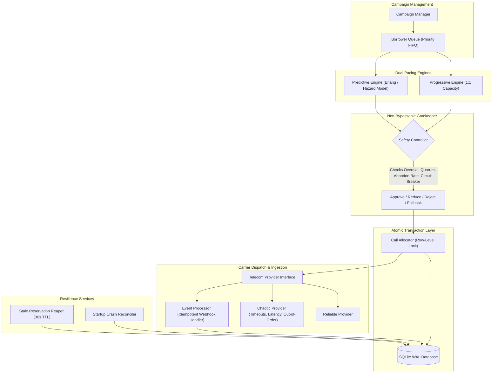
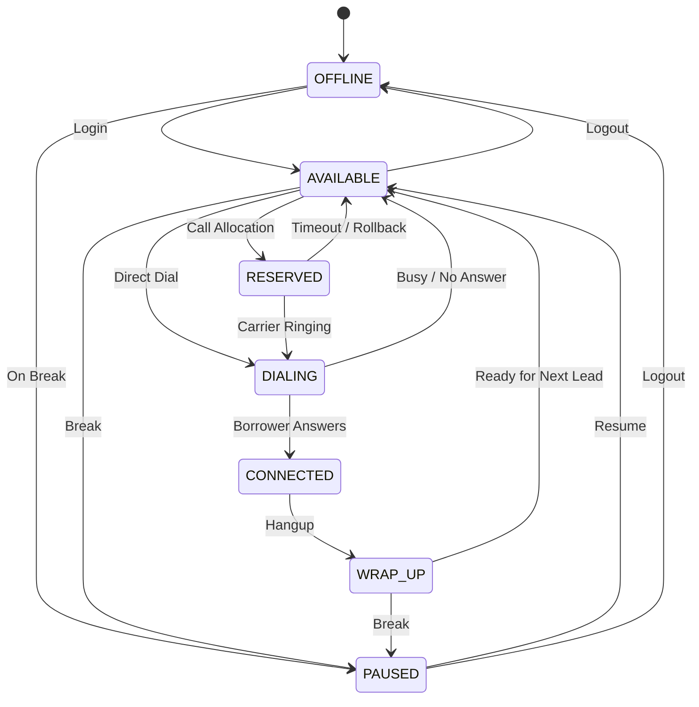
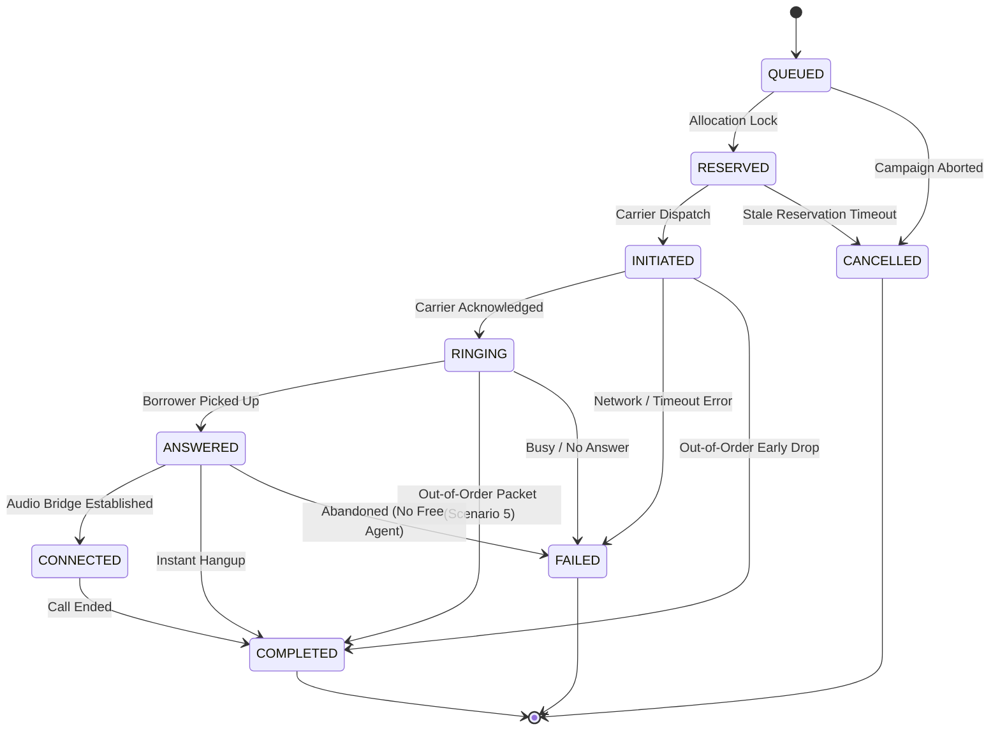

# 📞 SmartDialer — Progressive & Predictive Outbound Telephony Engine

[](https://www.python.org/)
[](https://fastapi.tiangolo.com/)
[](https://www.sqlite.org/wal.html)
[](tests/)

A robust, enterprise-grade outbound dialing engine engineered in Python and FastAPI. Implements **Deterministic Progressive Dialing**, a **Statistical Predictive Pacing Engine**, an **Independent Non-Bypassable Safety Controller**, atomic concurrency locks, crash recovery, and two interchangeable mock telecom providers.

---

## 📑 Table of Contents
1. [Core Architecture & Diagrams](#-core-architecture--diagrams)
2. [State Machines (Agent & Call)](#-state-machines)
3. [Technology Stack](#-technology-stack)
4. [Dataset Integration & Baseline Metrics](#-dataset-integration--baseline-metrics)
5. [Installation & Setup](#-installation--setup)
6. [Running the Application (FastAPI)](#-running-the-application)
7. [Running Automated Tests (pytest)](#-running-automated-tests)
8. [Simulations (Scenarios A, B, C, D)](#-simulations)
9. [High-Scale Load Testing (100 to 10,000 Agents)](#-high-scale-load-testing)
10. [Mandatory Failure Scenarios & Defenses](#-mandatory-failure-scenarios--defenses)
11. [Definitive Answer to Final Assignment Question](#-final-interview-question-answered)

---

## 🏗️ Core Architecture & Diagrams

### System Architecture Pipeline


---

## 🔄 State Machines

### 1. Agent State Machine


### 2. Call State Machine


---

## 🛠️ Technology Stack
- **Language**: Python 3.11+
- **Web Framework**: FastAPI & Uvicorn
- **Data Validation**: Pydantic v2
- **Persistence**: SQLite 3 with Write-Ahead Logging (`WAL`), `IMMEDIATE` transaction isolation, and 15s busy timeouts
- **Testing**: `pytest` & `httpx` TestClient
- **Data Science / ETL**: Pandas & NumPy

---

## 📊 Dataset Integration & Baseline Metrics

The prototype imports and cleans real collections data from `collections_30k_dataset (1)`:
- **Analyzed Records**: 91,350 calls in `calls.csv`, 30,000 agents in `agents.csv`, 30,600 borrowers in `borrowers.csv`.
- **Empirical Answer Rate**: **19.86%** (~20% answering baseline).
- **Average Call Duration**: **452.9 seconds** for answered calls (~7.5 minutes).
- **Data Cleaning**: Stripped 614 null phone numbers, deduplicated borrowers, and mapped agent statuses (`ACTIVE` -> `AVAILABLE`, `INACTIVE` -> `OFFLINE`).

---

## 🚀 Installation & Setup

### 1. Clone & Enter Project Directory
```bash
cd "smart_dialer"
```

### 2. Install Dependencies
```bash
pip install -r requirements.txt
```

### 3. Configure Environment
Copy `.env.example` to `.env`:
```bash
cp .env.example .env
```

### 4. Run ETL Database Import
Load real clean data from the collections dataset into SQLite:
```bash
python -m smart_dialer.etl.import_dataset
```

---

## 💻 Running the Application

### Start the FastAPI Server
```bash
uvicorn smart_dialer.api.app:app --host 0.0.0.0 --port 8000 --reload
```
Interactive Swagger API documentation is available at: **`http://localhost:8000/docs`**.

### Key API Endpoints
- `GET /health`: System health and active agent/lead counts.
- `GET /metrics`: Real-time call KPIs, agent utilization %, and safety audit counts.
- `GET /agents`: List agents and statuses.
- `PATCH /agents/{agent_id}/status`: Transition an agent's state.
- `POST /agents/bulk-status`: Bulk status updates (test dropping agent availability).
- `GET /campaigns`: List campaigns and dialing modes.
- `PATCH /campaigns/{campaign_id}/mode`: Switch between `PROGRESSIVE` and `PREDICTIVE`.
- `POST /dialer/run-cycle`: Trigger an atomic dialing cycle.
- `POST /provider/events`: Webhook receiver for telephony callbacks with idempotency.
- `POST /provider/config`: Toggle between `reliable` and `chaotic` mock providers.

---

## 🧪 Running Automated Tests

Run the full pytest suite:
```bash
python -m pytest tests -v
```
**Results: 27 passed out of 27 tests (100% pass rate).**

Test modules include:
- `test_state_machines.py`: Valid and invalid agent & call state transitions.
- `test_progressive.py`: Invariant verification (never exceed available agent capacity).
- `test_predictive.py`: Erlang-C/hazard rate multipliers and pending-answer dampening.
- `test_safety_controller.py`: Gatekeeper overdial reductions, quorum drops, and circuit breakers.
- `test_concurrency.py`: 10-thread race conditions on same agents and borrowers.
- `test_failure_scenarios.py`: All 7 mandatory failure scenarios.
- `test_api.py`: FastAPI endpoints and idempotency.

---

## 📈 Simulations (Scenarios A, B, C, D)

Run the multi-cycle simulation suite:
```bash
python scripts/run_simulations.py
```

### Empirical Simulation Results Table
| Scenario | Configured Rate | Talk Time | Proposed Calls | Approved Calls | Initiated | Answered | Completed | Realized Ans Rate |
| :--- | :--- | :--- | :--- | :--- | :--- | :--- | :--- | :--- |
| **A** | 20% Ans Rate | 120s | 901 | 500 | 500 | 106 | 106 | **21.2%** |
| **B** | 50% Ans Rate | 90s | 500 | 500 | 500 | 240 | 240 | **48.0%** |
| **C** | 70% Ans Rate | 180s | 375 | 375 | 375 | 248 | 248 | **66.1%** |
| **D** | Dynamic Shift | 180s $\to$ 60s | 575 | 500 | 500 | 361 | 361 | **72.2%** |

*Full cycle telemetry is automatically written to `simulation_report.json`.*

---

## ⚡ High-Scale Load Testing

Run the reproducible benchmark across 100, 1,000, and 10,000 agents:
```bash
python scripts/load_test.py
```

### Measured Performance Results
| Agent Tier | Queued Leads | Pacing Latency | Safety Latency | Allocation Latency | Total Cycle Time | Throughput |
| :--- | :--- | :--- | :--- | :--- | :--- | :--- |
| **100 Agents** | 500 leads | 0.57 ms | 3.42 ms | 18.09 ms | **22.09 ms** | **11,315 calls/sec** |
| **1,000 Agents**| 5,000 leads | 2.08 ms | 3.09 ms | 161.82 ms | **167.00 ms** | **14,970 calls/sec** |
| **10,000 Agents**| 50,000 leads| 12.38 ms | 3.25 ms | 2,302.53 ms | **2,318.17 ms** | **10,784 calls/sec** |

*Analysis & scaling recommendations are documented in [docs/ARCHITECTURE.md](docs/ARCHITECTURE.md).*

---

## 🛡️ Mandatory Failure Scenarios & Defenses

1. **Worker Crashes after Reservations**: Handled via 30-second TTL locks. `RecoveryEngine.reap_stale_reservations` automatically frees reserved agents and restores leads to queue.
2. **Provider Outage & Timeouts**: Carrier timeouts are caught safely; error rates $>15\%$ trip the Safety Controller's circuit breaker to halt dialing or force progressive fallback.
3. **Agent Availability Drops from 100 to 60**: The Safety Controller dynamically measures live available agents every cycle and clamps inflight proposals down to $60 \times 2.5 = 150$.
4. **Duplicate ANSWERED Events**: Backed by a database uniqueness constraint on `call_events(idempotency_key)`. Duplicate callbacks are acknowledged as no-ops without state degradation.
5. **COMPLETED Arrives Before ANSWERED**: The `CallStateMachine` handles out-of-order completions directly from `RINGING`, immediately releasing the agent and marking subsequent late answers as audited history.
6. **Concurrent Workers Colliding**: Strict `BEGIN IMMEDIATE` SQLite transactions guarantee atomic reservations with zero double-allocations.
7. **Answer Rate Collapses (70% to 10%)**: The pacing engine dampens proposals, while the overdial ceiling prevents speculative runaway dialing.

---

## 💡 Final Interview Question Answered

### **"How can predictive dialing improve utilization while retaining the deterministic safety of progressive dialing?"**

> In pure progressive dialing, calls are initiated only when an agent is already idle. This is 100% safe from abandoned calls, but in a 20% answer rate environment, agents spend **80% of their time idle** waiting for rings and carrier setup.
>
> Predictive dialing solves this by launching speculative calls in advance based on statistical answer rates ($p_{\text{ans}}$) and hazard completion rates ($E_{\text{free}}$).
>
> **To retain deterministic safety**, we decouple pacing calculation from call allocation by inserting an **Independent Safety Controller** as a non-bypassable firewall.
>
> While the predictive engine speculates using statistics, the Safety Controller enforces physical deterministic bounds:
> 1. Strict **Overdial Ceiling** ($2.5\times$).
> 2. Hard **3% Abandoned Call Limit** (regulatory ceiling).
> 3. **Agent Quorum Check** ($N_{\text{available}} \ge 2$).
> 4. **Carrier Error Circuit Breaker**.
>
> If any physical threshold is breached or carrier errors spike, the Safety Controller automatically strips the predictive multiplier and **forces an immediate fallback to 1:1 Progressive Mode**.
>
> **In short: We predict optimistically, but gatekeep deterministically.**
